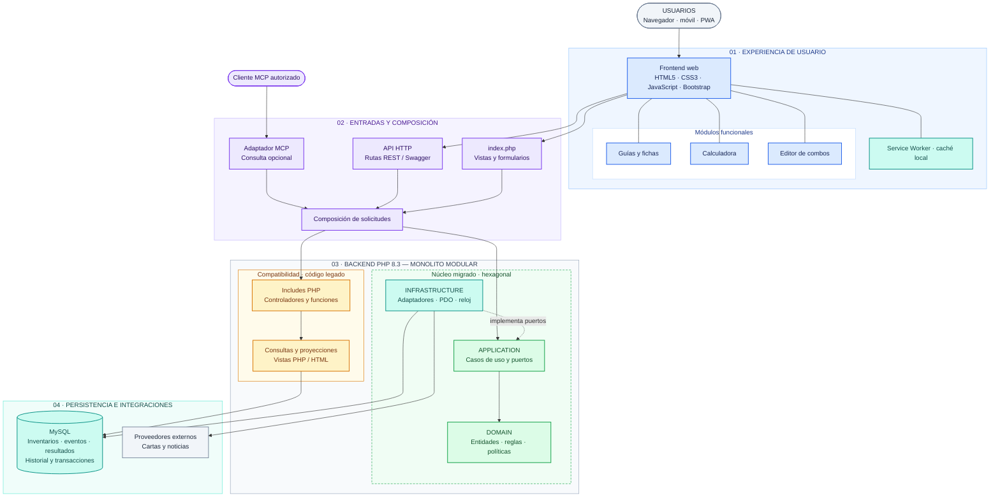
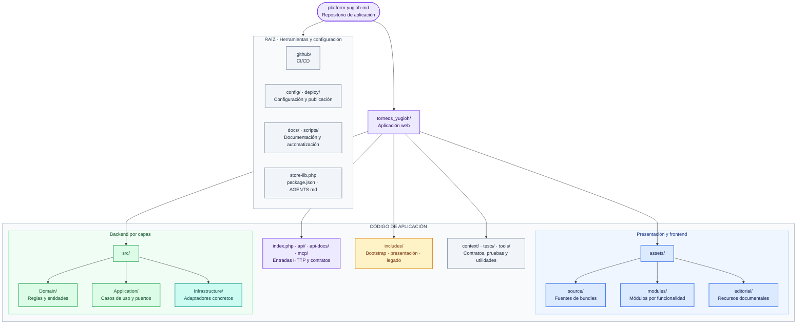
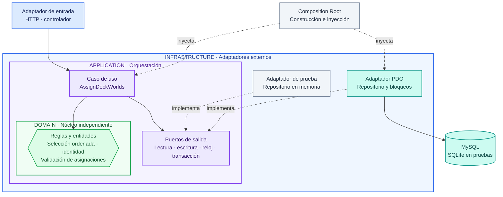
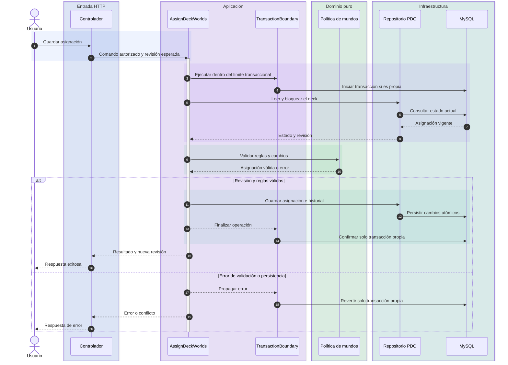
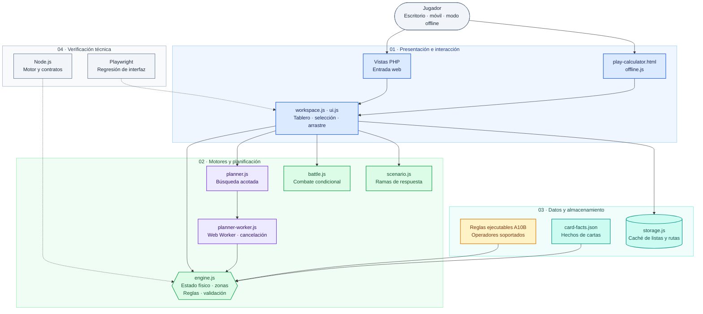
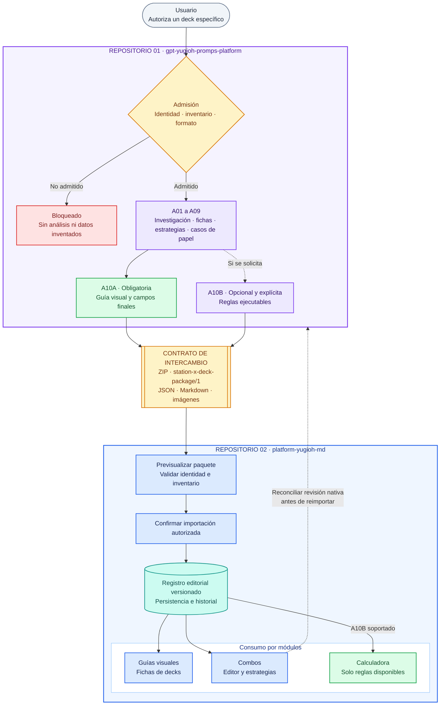
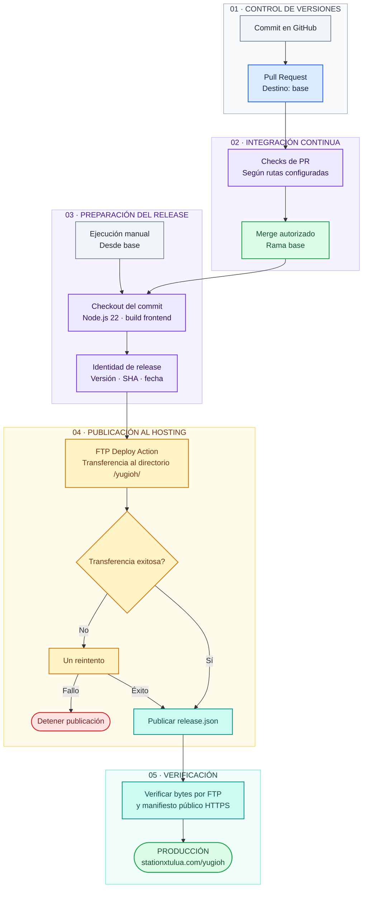
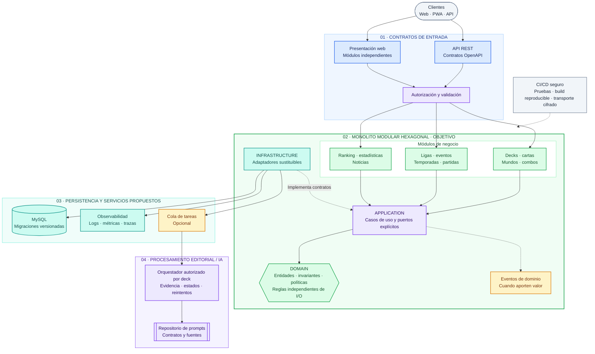

# Station X · Plataforma Yu-Gi-Oh

Plataforma web para administrar decks, equipos, temporadas, eventos y resultados de Yu-Gi-Oh, con guías de juego, un editor visual de combos y herramientas de estudio.

## Estándar de análisis y seguimiento por deck — contrato compartido con GPT

Station X es una plataforma de registro y estudio de **duelos físicos**, no un simulador universal. **No se ejecuta ningún análisis A01–A10A/A10B sin que el usuario asigne expresamente un único `deck_id`**, y el sistema no procesa por defecto el catálogo completo de decks. Enumerar decks, actualizar documentación, consultar avances o probar la infraestructura NO constituye autorización para analizar ningún mazo.

### Elegibilidad y precondiciones

La puerta editorial previa al primer prompt valida el `deck_id` seleccionado, formato e inventario físico del **mismo deck**. Debe existir al menos una fila/copia cargada en **Main**, **Extra** y **Side**; la sección **Reserva es opcional** y nunca se rellena por defecto. Cada fila se coteja por `card_id`, sección y cantidad contra el `record.cards[*].slots` del paquete. La falta de selección o de cualquiera de las zonas requeridas produce `BLOQUEADO_POR_INVENTARIO_O_AUTORIZACION`; **no se ejecutan tareas A01–A10 ni un estudio provisional**. Esta exigencia no impide guardar o editar un deck incompleto en el catálogo: impide iniciar el **análisis por IA**.

El contrato canónico y el validador de entrada pertenecen a [GPT Yu-Gi-Oh Prompts](https://github.com/senior23enginer-coder/gpt-yugioh-promps-platform): `scripts/analysis-eligibility.cjs`. Los controles definidos aquí sirven para estandarizar el **futuro orquestador de análisis**, no constituyen por sí mismos un servicio de IA ni un proceso de análisis en producción.

### Flujo y fuente de verdad

| Etapa | Tipo | Responsabilidad |
| --- | --- | --- |
| A01–A04 | Obligatoria tras admisión | Identidad, inventario cargado, fuentes e imágenes |
| A05–A07 | Obligatoria | Fichas y reglas semánticas por `cid` y `effect_id`, costes, ventanas, material, límites y casos de papel |
| A08–A09 | Obligatoria | Estrategias, `route_id`/`step_id`, recursos y estados previos/posteriores |
| **A10A** | **Obligatoria** | Guía visual, campos finales y ZIP importable **sin depender de la calculadora** |
| **A10B** | **Opcional y explícita** | Mapeo de casos de papel a reglas `station-x-calculator/1`, pruebas de motor y compatibilidad |

El contrato importable `station-x-deck-package/1` mantiene `record` estructurado y el inventario por filas; las reglas ejecutables `record.calculator` se incorporan sólo cuando A10B fue solicitado y los operadores existen. La guía y la calculadora consumen **los mismos IDs, condiciones, efectos y recursos**. Las pruebas de papel/semántica de dominio se originan en GPT como datos; las pruebas técnicas del intérprete, del ZIP y de los cambios de estado físico viven en Platform. Un fallo de una prueba o un operador no soportado **no** se convierte en un resultado de duelo inventado.

### Ledger por deck, tareas y tiempos reales

A01 incorpora T4/T5 (paridad Markdown/JSON y prueba de importación/presentación). Los checklists históricos de 35 tareas no se completan por inferencia; los paquetes certificados declaran `record.a01_profile_contract=station-x-a01-profile/1`.


El único manifiesto de referencia, mantenido en GPT, es `02_PROMPT_PARA_CODEX/contrato_tareas_a01_a10.json`, con **37 tareas A01–A10A obligatorias y 3 A10B opcionales**. En este repositorio, `scripts/deck-analysis-ledger.cjs` ofrece funciones genéricas, sin efectos secundarios, para:

- Rechazar una inicialización sin asignación expresa, sin las tres zonas cargadas o sin un manifiesto válido.
- Conservar `PENDING`, `RUNNING`, `PAUSED`, `BLOCKED` y `COMPLETE`, IDs estables y evidencia obligatoria antes de completar cualquier tarea. A10B no cuenta ni puede arrancar si no se solicitó.
- Acumular tiempos **observados** por sesión a partir de marcas UTC `started_at`/fin; conservar reintentos y bloqueos.
- Calcular progreso por apartado y exponer `eta_seconds=null` con `INSUFFICIENT_REAL_SAMPLES` hasta disponer de al menos cinco duraciones históricas comparables de decks distintos **para cada tarea abierta**. Cuando existen, utiliza la mediana; el consumidor debe filtrar previamente muestras por complejidad y formato para que sean comparables.

**Implementación de seguimiento (PR de infraestructura):** `includes/decks/analysis-progress.php` guarda el ledger por deck en una tabla SQL independiente, con bloqueo por huella de inventario, versión optimista y evidencia obligatoria. `includes/decks/analysis-progress-http.php` expone un endpoint autenticado de lectura/escritura con CSRF y autorización expresa; `assets/modules/deck-guide/analysis-progress.js` y su CSS presentan la cuadrícula en la ficha seleccionada. Abrir un deck **no crea registros ni inicia IA**: el usuario debe confirmar expresamente su asignación al seguimiento y después documentar cada transición. La vista muestra progreso, bloqueos y tiempo real; el ETA permanece sin datos cuando no hay cinco decks comparables medidos por tarea. La inicialización y las acciones se aplican **solo al deck seleccionado**, nunca a todo el catálogo.

**Limitación que permanece:** todavía no existe un agente de ejecución autónoma de A01–A10A, ni una base empírica de tiempos de análisis reales para calibrar ETA. El grid registra trabajo ya autorizado y efectivamente evidenciado, pero **no ejecuta prompts, investiga cartas, realiza importaciones ni agenda tareas por sí solo**. El despliegue visible dependerá de que el PR se integre y el servidor admita la tabla SQL; no confundir código probado en CI con publicación verificada.

### Pruebas reproducibles y límites de alcance

```bash
node scripts/deck-analysis-ledger-test.cjs
php torneos_yugioh/tests/deck_analysis_progress_test.php
node torneos_yugioh/tests/deck_analysis_progress_ui_test.cjs
node torneos_yugioh/tests/deck_logic_fixture_runner_test.cjs
npm test
# Con un clon hermano de GPT y su contrato de tareas:
node scripts/deck-analysis-ledger-test.cjs ../gpt-yugioh-promps-platform/02_PROMPT_PARA_CODEX/contrato_tareas_a01_a10.json
```

La prueba nueva usa **escenarios sintéticos exclusivamente**; no selecciona, investiga ni modifica ningún deck. `npm test` conserva las regresiones existentes y el workflow de integración ZIP comprueba los 38 IDs contra el manifiesto de GPT. Los tests históricos de Memento/Crystron verifican código y paquetes ya existentes, **no son nuevas ejecuciones A01–A10** ni viajan dentro del ZIP. Para evitar proliferación se incorpora `scripts/run-deck-logic-fixtures.cjs`: un ejecutor genérico de escenarios positivos/negativos expresados como datos, con comprobación estricta de deck asignado, formato, inventario y estado físico. Su ejecución sólo está permitida sobre un deck real asignado expresamente. Las pruebas de ejemplo son **sintéticas**. Esta capacidad todavía no certifica todas las operaciones de motor y no sustituye los tests históricos hasta acreditar paridad. El adaptador `fromPaper(paper,stationxPackage,{deckId,explicitlyAssigned})` recibe el esquema canónico `station-x-paper-cases/1` de GPT y el paquete `station-x-deck-package/1`, conserva los `effect_id`/`case_id` y genera únicamente fixtures para efectos con reglas A10B disponibles. Los casos condicionales, sin estados físicos estructurados o sin operador se devuelven como **bloqueados**, nunca como pruebas exitosas. No borrar tests antiguos hasta disponer de evidencia equivalente.

### P06 — Migración segura de pruebas por carta a casos de papel reutilizables

El objetivo es **evitar nuevos archivos JavaScript/PHP por carta o deck**, no borrar verificaciones históricas. Se preservan **40** archivos de regresión de Memento y Crystron/Horus mediante `scripts/deck-legacy-regression-gate.cjs`. Ejecutar `node scripts/deck-legacy-regression-gate.cjs` comprueba el inventario sin analizar cartas; agregar `--run` ejecuta las 40 regresiones heredadas de forma independiente, sin invocar A01–A10.

**GPT es dueño de los casos de dominio:** `03_COMPROBACIONES_NO_IMPORTAR/fixtures/p06-legacy-paper-cases.json` contiene un primer conjunto de 8 casos lógicos declarativos: **3** corresponden directamente a aserciones históricas con texto trazable y **5** son escenarios negativos adicionales. No son ocho pruebas históricas completas migradas ni reemplazan las demás aserciones. Platform verifica esos casos y sus dos archivos históricos de origen mediante el ejecutor compartido `scripts/deck-paper-parity.cjs`, sin cambiar ningún deck:

```bash
node scripts/deck-legacy-regression-gate.cjs
node scripts/deck-legacy-regression-gate.cjs --run
node scripts/deck-paper-parity.cjs ../gpt-yugioh-promps-platform/03_COMPROBACIONES_NO_IMPORTAR/fixtures/p06-legacy-paper-cases.json
```

`scripts/run-deck-logic-fixtures.cjs` interpreta los casos de efecto. Su función `runRoutes` permite contrastar también pasos de secuencias A09 mediante `route_id`, efectos existentes y estados físicos comprobables; ante ramas ambiguas, operadores ausentes o checkpoints falsos, **falla cerrado**. La suite sintética valida estos límites sin analizar decks.

**Regresiones de rutas A09:** GPT conserva las doce rutas Memento C01–C12 en un único registro histórico de 105 transiciones y en un archivo de estados de referencia (`p06-memento-golden-route-states.json`). `scripts/export-p06-route-golden.cjs` caracteriza los tests originales sin editarlos; `scripts/run-p06-golden-routes.cjs` reproduce sus estados con el motor actual. **C08** incluye cambio de turno y observación explícita de activación rival. Son **12/12 replays históricos reproducidos**, pero eso **no** certifica todas las posibles jugadas o un oráculo reglamentario independiente.

**Auditoría de cobertura restante:** `scripts/export-p06-legacy-inventory.cjs` y `scripts/check-p06-legacy-assertions.cjs` cotejan los 40 scripts, huellas Git y **1.005 sitios textuales de llamadas a `assert`** contra `p06-protected-legacy-assertions.json` de GPT. El número 1.005 es un conteo estático, **no equivale a 1.005 casos lógicos verificados o migrados**. Las tres aserciones históricas de papel y los cinco casos negativos adicionales tampoco reemplazan archivos completos.

```bash
node scripts/export-p06-route-golden.cjs
node scripts/export-p06-legacy-inventory.cjs
node scripts/run-p06-golden-routes.cjs ../gpt-yugioh-promps-platform/03_COMPROBACIONES_NO_IMPORTAR/fixtures/p06-memento-golden-route-states.json
node scripts/check-p06-legacy-assertions.cjs ../gpt-yugioh-promps-platform/03_COMPROBACIONES_NO_IMPORTAR/fixtures/p06-protected-legacy-assertions.json
```

**Discrepancia pendiente C02:** el documento histórico registra seis transiciones, pero el test contiene cinco acciones efectivamente ejecutadas. La reproducción de esas cinco acciones pasa; el conteo editorial sigue sin conciliar y **no debe corregirse silenciosamente ni declararse coincidente**.

**Control preventivo de crecimiento:** `scripts/p06-test-source-allowlist.json` registra los **212 programas de prueba existentes** en `torneos_yugioh/tests`; `node scripts/guard-p06-test-program-growth.cjs` verifica su presencia y rechaza incorporaciones o supresiones silenciosas. Los nuevos escenarios por deck, carta o combo deben registrarse en **fixtures JSON** para el runner compartido, no como nuevos ficheros `*_test.cjs`/`.php` por efecto. Agregar un test técnico nuevo al núcleo del motor sigue siendo posible, pero exige actualizar justificadamente la lista en un PR revisado. Esto es un control de gobernanza, **no** prueba por sí solo la equivalencia semántica de los 40 scripts heredados.

**Estado de migración:** el **framework de fixtures/replays reutilizables está operativo** y todos los tests históricos siguen protegidos; **la conversión completa de las aserciones de dominio y la retirada de archivos redundantes están pendientes**. No suprimir scripts hasta documentar y comprobar la equivalencia exacta de cada aserción relevante; mantener en Platform aquellas que son técnicas del motor, UI y contratos y llevar al origen GPT las pruebas de papel por efecto. No se ha reanalizado ningún deck.

**Política de cambios:** esta documentación y las utilidades no autorizan merge, despliegue FTP ni actualizaciones de producción. Los PR de GPT y Platform deben pasar sus verificaciones de forma independiente antes de cualquier integración.


| Recurso                      | Enlace                                                                                            |
| ---------------------------- | ------------------------------------------------------------------------------------------------- |
| Aplicación en producción     | [stationxtulua.com/yugioh](https://stationxtulua.com/yugioh/)                                     |
| Swagger en producción        | [Documentación interactiva](https://stationxtulua.com/yugioh/api-docs/)                           |
| Repositorio de la aplicación | [platform-yugioh-md](https://github.com/senior23enginer-coder/platform-yugioh-md)                 |
| Prompts e investigación      | [gpt-yugioh-promps-platform](https://github.com/senior23enginer-coder/gpt-yugioh-promps-platform) |
| Integración y despliegue     | [GitHub Actions](https://github.com/senior23enginer-coder/platform-yugioh-md/actions)             |

## Contenido

- [Alcance y estado](#alcance-y-estado)
- [Requisitos](#requisitos)
- [Instalación local](#instalación-local)
- [Configuración](#configuración)
- [Estructura del repositorio](#estructura-del-repositorio)
- [Arquitectura y edición del código](#arquitectura-y-edición-del-código)
- [Stack tecnológico y arquitectura de software](#stack-tecnológico-y-arquitectura-de-software)
- [API y Swagger](#api-y-swagger)
- [Importación y contenido de decks](#importación-y-contenido-de-decks)
- [Comandos y pruebas](#comandos-y-pruebas)
- [Ramas y colaboración](#ramas-y-colaboración)
- [Despliegue](#despliegue)
- [Diagnóstico de problemas](#diagnóstico-de-problemas)
- [Documentación de referencia](#documentación-de-referencia)

## Alcance y estado

| Área                     | Funcionalidad y límites                                                                                                                                      |
| ------------------------ | ------------------------------------------------------------------------------------------------------------------------------------------------------------ |
| Decks y equipos          | Catálogo, ficha, listas Main/Extra/Side/Reserva, multimedia y relaciones con equipos.                                                                        |
| Mundos                   | Asignación ordenada de uno a tres mundos para decks TCG; el primero es el principal.                                                                         |
| Eventos                  | Temporadas, ligas, copas, divisiones, calendario, enfrentamientos y resultados.                                                                              |
| Estadísticas y tops      | Ranking por formato, ranking global, metagame y tablas según los resultados registrados.                                                                     |
| Guías y combos           | Biblioteca documental, fotografías, pasos, planes y editor visual con revisiones.                                                                            |
| Calculadora de jugadas   | Práctica y captura de escenarios, manos y consulta de líneas disponibles. La cobertura del motor depende de las reglas implementadas para cada deck/formato. |
| Inspector de cartas      | Consulta local y del proveedor de cartas, imagen y texto disponible.                                                                                         |
| Importar / exportar Data | Intercambio de un deck por ZIP con previsualización, control de identidad e inventario.                                                                      |
| API de Decks             | Swagger publica 13 operaciones implementadas mediante 10 rutas; la propuesta de 37 endpoints REST todavía no está implementada.                              |
| Conexión con ChatGPT     | Integración MCP de consulta, opcional y con configuración privada independiente.                                                                             |

La plataforma conserva código nativo junto con funcionalidades migradas a puertos y adaptadores. No se considera terminada la migración completa a arquitectura hexagonal. Una guía importada tampoco equivale a una secuencia certificada por un motor de reglas. Consultar el [estado de arquitectura](torneos_yugioh/context/architecture-migration-status.md) y los límites de la [calculadora](torneos_yugioh/context/play-calculator.md).

Los recuentos de decks, cartas y rutas cambian con las entregas y las operaciones de la plataforma. Los números de pruebas históricas describen sus fixtures, no necesariamente el catálogo vivo.

## Requisitos

| Componente                 | Uso                                                                                                   |
| -------------------------- | ----------------------------------------------------------------------------------------------------- |
| PHP 8.3                    | Ejecución de la aplicación.                                                                           |
| MySQL                      | Persistencia de la plataforma; usar una base independiente para desarrollo.                           |
| PDO MySQL, mbstring y cURL | Conexión, tratamiento de texto e integraciones del backend.                                           |
| ZipArchive (`zip`)         | Importación y exportación de paquetes de decks.                                                       |
| DOM/SimpleXML              | Lectura de fuentes de noticias según el formato recibido.                                             |
| Node.js 22 y npm           | Dependencias, generación de recursos y pruebas; es la versión configurada en CI.                      |
| Python 3.11 o posterior    | Herramientas editoriales y parte de la suite local; no se necesita para importar un ZIP desde la web. |
| PDO SQLite                 | Pruebas locales aisladas de persistencia.                                                             |
| Playwright y Chromium      | Pruebas de navegador, incluida la de Swagger.                                                         |

En producción se publican PHP y recursos ya preparados. El servidor web no necesita instalar Node.js, npm, Python ni Playwright para atender la aplicación. Para Apache, habilitar las reglas de `.htaccess` y `mod_rewrite`.

El arranque normal puede inicializar o evolucionar tablas y valores base. **Configurar una base de desarrollo antes de abrir la aplicación local; no apuntarla a producción para hacer pruebas.**

## Instalación local

### 1. Clonar la aplicación

```sh
git clone --branch base https://github.com/senior23enginer-coder/platform-yugioh-md.git
cd platform-yugioh-md
```

El repositorio de prompts es independiente. Si se necesitan sus herramientas editoriales, clonarlo como carpeta hermana:

```sh
git clone --branch base https://github.com/senior23enginer-coder/gpt-yugioh-promps-platform.git ../gpt-yugioh-promps-platform
```

No crear `context/gpt/` dentro de la aplicación ni copiar los repositorios al antiguo workspace `xstation`. La copia de migración `xstation/torneos_yugioh` fue retirada.

### 2. Configurar la base de desarrollo

En PowerShell:

```powershell
Copy-Item config/database.example.php config/database.local.php
```

En Linux/macOS:

```sh
cp config/database.example.php config/database.local.php
```

Editar `config/database.local.php` con la conexión propia. El archivo debe devolver un array con `host`, `port`, `database`, `username`, `password`, `prefix` y `entity`. La base y el usuario deben existir; el repositorio no contiene la base de datos de producción. El archivo local está ignorado por Git.

### 3. Instalar dependencias y preparar recursos

```sh
npm ci
npm run build
npm run build:swagger
```

### 4. Iniciar PHP

```sh
php -S 127.0.0.1:8080 -t torneos_yugioh
```

- Aplicación: <http://127.0.0.1:8080/>
- Swagger: <http://127.0.0.1:8080/api-docs/>
- OpenAPI: <http://127.0.0.1:8080/api-docs/openapi.json>

El servidor integrado de PHP es para desarrollo. En producción la aplicación se sirve bajo `/yugioh/`; revisar `RewriteBase` y las rutas públicas si cambia su ubicación.

## Configuración

El puente de compatibilidad [store-lib.php](store-lib.php) proporciona sesión/CSRF, escape HTML y conexión PDO. No incorpora el código de la tienda.

### Prioridad de la conexión

1. `config/database.local.php`.
2. Configuración privada de Dolibarr indicada por `STATION_X_DOLIBARR_CONFIG`, o `htdocs/conf/conf.php` si existe.
3. Variables de entorno `YGO_DB_*`.

| Variable                      | Propósito                                                               | Valor por defecto                      |
| ----------------------------- | ----------------------------------------------------------------------- | -------------------------------------- |
| `YGO_DB_HOST`                 | Host MySQL                                                              | `127.0.0.1`                            |
| `YGO_DB_PORT`                 | Puerto MySQL                                                            | `3306`                                 |
| `YGO_DB_NAME`                 | Nombre de base                                                          | Obligatorio si se usa este mecanismo   |
| `YGO_DB_USER`                 | Usuario de base                                                         | Obligatorio si se usa este mecanismo   |
| `YGO_DB_PASSWORD`             | Contraseña de base                                                      | Vacío                                  |
| `YGO_DB_PREFIX`               | Prefijo utilizado por el puente compartido                              | `llx_`                                 |
| `YGO_DB_ENTITY`               | Entidad del puente                                                      | `1`                                    |
| `STATION_X_DOLIBARR_CONFIG`   | Ruta al archivo privado de configuración existente                      | `htdocs/conf/conf.php` junto al puente |
| `YGO_PROMPTS_ROOT`            | Raíz del repositorio independiente para las herramientas que la admiten | Repositorio hermano                    |
| `STATION_X_CHATGPT_CONFIG`    | Ruta de configuración privada de la conexión MCP                        | Ver documentación de ChatGPT           |
| `PHP_BINARY`, `PYTHON_BINARY` | Ejecutables utilizados por el lanzador de pruebas                       | `php`, `python`                        |
| `RUN_EDITORIAL_SOURCE_TESTS`  | Habilitar pruebas históricas que requieren entregas externas            | Desactivado; habilitar con `1`         |

Los nombres de tablas propios `sx_ygo_*` forman parte del esquema implementado; `YGO_DB_PREFIX` no renombra automáticamente todas las tablas de la aplicación. Las variables deben configurarse en el entorno del proceso: el puente no carga automáticamente un archivo `.env`.

La configuración MCP se prepara por separado. Consultar [chatgpt-connection.md](torneos_yugioh/context/chatgpt-connection.md); no guardar tokens ni archivos privados en el repositorio.

## Estructura del repositorio

```text
platform-yugioh-md/
├── .github/                     # Workflows y procedimiento FTP
├── config/                      # Ejemplos de configuración; archivos locales ignorados
├── deploy/                      # Recursos auxiliares de publicación, incluida conexión ChatGPT
├── docs/                        # Documentación de apoyo
├── scripts/                     # Build, formato e inventario de fuentes
├── torneos_yugioh/
│   ├── index.php                # Entrada y composición del flujo nativo
│   ├── api/                     # Adaptadores HTTP de operaciones documentadas
│   ├── api-docs/                # Swagger UI, OpenAPI y distribución fijada del proveedor
│   ├── assets/
│   │   ├── source/              # Fuentes del frontend legado
│   │   ├── modules/             # Funcionalidades frontend independientes
│   │   └── editorial/           # Recursos documentales utilizados en ejecución
│   ├── includes/                # Adaptadores nativos, bootstrap y presentación
│   ├── src/
│   │   ├── Domain/              # Reglas y políticas independientes de I/O
│   │   ├── Application/         # Casos de uso y puertos
│   │   └── Infrastructure/      # HTTP, PDO, archivos, proveedores y composición
│   ├── context/                 # Especificaciones y estado técnico
│   ├── mcp/                     # Entrada de conexión con ChatGPT
│   ├── tests/                   # Contratos, regresiones y escenarios de navegador
│   └── tools/                   # Herramientas editoriales y operativas
├── store-lib.php                # Puente de compatibilidad para desarrollo independiente
├── AGENTS.md                    # Reglas de trabajo y preservación de contratos
├── package.json                 # Comandos y dependencias de desarrollo
└── package-lock.json            # Resolución reproducible de dependencias
```

`outputs/`, `local-artifacts/`, `node_modules/`, cachés y configuraciones privadas son locales y están ignorados. No son entradas necesarias para iniciar un clon nuevo. `station_x_perfiles_67_decks.txt` es una referencia histórica; no reemplaza el inventario vivo ni el registro editorial activo.

## Arquitectura y edición del código

- **Domain:** sin PDO, variables HTTP, archivos, red ni llamadas a funciones nativas `ygo_*`.
- **Application:** coordina casos de uso mediante puertos explícitos; conserva la propiedad de transacciones y bloqueos.
- **Infrastructure:** implementa persistencia, transporte, caché, reloj y composición.
- **Compatibilidad:** `includes/` mantiene flujos existentes mientras se migran por funcionalidad. Trasladar un cuerpo procedural a otra carpeta no completa una migración hexagonal.

Mundos, metadatos de decks, combos, calendario compartido, noticias, catálogo y decklists tienen separación implementada en distintos alcances. El cargador global, parte de los formularios, estadísticas, importación y frontend legado conservan deuda. La referencia detallada es [architecture-migration-status.md](torneos_yugioh/context/architecture-migration-status.md).

### Frontend

Editar el código legado en `assets/source/`, siguiendo su manifiesto, y ejecutar `npm run build`. **No editar directamente los bundles generados `assets/app.js` y `assets/app.css`.**

Las funcionalidades nuevas se organizan en `assets/modules/<feature>/`. Las vistas de servidor se mantienen bajo `includes/<domain>/` y `includes/presentation/`. Ver [source-architecture.md](torneos_yugioh/context/source-architecture.md) y el [mapa de módulos](torneos_yugioh/assets/modules/README.md).

El formateador de arquitectura usa una lista explícita de fuentes migradas; no incluye todas las plantillas mixtas ni el material editorial. No regenerar huellas originales para ocultar cambios de comportamiento.

## Stack tecnológico y arquitectura de software

> Estado de la rama `base` revisado el 26 de noviembre de 2026. La inspección es estática; no certifica el servidor de producción ni una migración hexagonal completa.

### Stack tecnológico

| Tecnología | Versión / estado | Responsabilidad |
| --- | --- | --- |
| PHP | 8.3 (requisito) | Backend, casos de uso, controladores y vistas |
| JavaScript nativo | ES6+ | Frontend, motores de reglas y planificación |
| HTML / CSS | HTML5 / CSS3 | Interfaces adaptables |
| Bootstrap | Componentes presentes; versión no auditada | Modales y componentes UI |
| MySQL | Versión no verificada | Persistencia relacional |
| PDO | MySQL / SQLite | Consultas, repositorios y transacciones |
| SQLite | Pruebas locales | Persistencia aislada |
| Apache / mod_rewrite | Alojamiento compatible | Servidor HTTP y reescritura de rutas |
| Node.js / npm | Node.js 22 en CI | Build y pruebas |
| Python | 3.11+ | Herramientas editoriales y automatización |
| JSON / Markdown / ZIP | Contratos de datos | Guías y paquetes de decks |
| ZipArchive, mbstring, cURL, DOM/SimpleXML | Extensiones PHP | Importación, texto e integraciones |
| Service Worker / Web App Manifest | PWA | Caché y funcionalidad offline acotada |
| Playwright / Chromium | Playwright 1.46.1 | Pruebas UI y regresión |
| Prettier / plugin PHP | 3.6.2 / 0.26.0 | Formato y control de código |
| Swagger UI / Swagger Parser | 5.35.1 / 12.1.0 | Documentación y validación OpenAPI |
| MCP SDK | ^1.32.2 | Herramientas de desarrollo para MCP |
| GitHub Actions / FTP | FTP Deploy Action v4.4.0 | CI/CD y publicación |

Versiones de dependencias según [package.json](package.json). No se utiliza React, Angular, Vue ni Next.js como framework principal. Node.js y Python no son necesarios para atender las solicitudes normales en producción. Las versiones reales de PHP, Apache y MySQL deben verificarse en el servidor.

### Patrones arquitectónicos

| Patrón | Estado | Alcance |
| --- | --- | --- |
| Monolito modular | Implementado, en evolución | Una aplicación PHP con módulos y persistencia compartida |
| Arquitectura hexagonal (Ports & Adapters) | Parcial | Casos de uso, dominio puro, puertos y adaptadores |
| Arquitectura por capas | Parcial | Domain, Application, Infrastructure y presentación |
| DDD | Elementos presentes | Identidades, entidades y políticas; no DDD estratégico completo |
| SOLID e inyección de dependencias | Parcial | Contratos, reloj, transacciones y repositorios sustituibles |
| Repository Pattern | Implementado en flujos migrados | Persistencia mediante contratos |
| MVC | Elementos en el legado | Controladores y vistas PHP; no un framework MVC formal |
| Feature-Based Architecture | Parcial | Módulos frontend por funcionalidad |
| API REST | Parcial | Rutas documentadas, endpoints nativos y formularios |
| PWA | Implementada con alcance limitado | Manifest, service worker y calculadora offline |
| Microservicios | No implementados como arquitectura general | Módulos y repositorios separados no equivalen a microservicios |
| Event-Driven Architecture | No implementada como arquitectura general | Eventos deportivos y auditoría no equivalen a un bus distribuido |

### Arquitectura actual



Es una arquitectura híbrida: el núcleo migrado convive con componentes procedimentales. El diagrama representa responsabilidades y flujos de ejecución, no servicios desplegados independientemente.

### Organización del código



La estructura detallada y las responsabilidades de cada carpeta se conservan en la sección [Estructura del repositorio](#estructura-del-repositorio).

### Arquitectura hexagonal y dependencias



- **Domain:** reglas, entidades y políticas independientes de PDO, HTTP, sesiones y archivos.
- **Application:** casos de uso, comandos, consultas y puertos explícitos.
- **Infrastructure:** HTTP, persistencia, red, caché, configuración, composición, reloj y transacciones.

Ejemplo implementado: `attributes-http.php` → `DeckWorldsController` → `AssignDeckWorlds` / `DeckWorldsQueries` → puertos → adaptadores PDO.



El diagrama ilustra el flujo transaccional principal y una rama de error simplificada; no pretende reproducir cada llamada interna. El límite transaccional inyectado confirma o revierte únicamente transacciones propias; las guardas y conflictos detallados se documentan en el contrato del módulo.

### Dominios y avance de migración

| Dominio | Domain | Application | Alcance |
| --- | --- | --- | --- |
| Calendar | Sí | Sí | Reflujo, cupos y prioridad; generación integral pendiente |
| CardCatalog | Sí | Sí | Identidad, proveedor, caché e imágenes; integración externa pendiente de certificar |
| Combos | Sí | Sí | Grafo, consultas, guardado, historial; fuentes editoriales con legado |
| Competitions | Sí | No específico | Políticas deportivas extraídas; flujos de eventos pendientes |
| DeckMetadata | Sí | Sí | Estilo, arquetipo y lectura editorial |
| DeckWorlds | Sí | Sí | Asignación, consultas, persistencia y transacciones separadas |
| Decks / Decklists | Sí | Sí | Guardado y consulta de listas; ZIP y frontend compartido pendientes |
| Matches | Sí | No específico | Reglas extraídas; parte de la coordinación sigue en legado |
| News | Sí | Sí | Normalización, consulta y sincronización; concurrencia MySQL pendiente |
| Seasons | Sí | Sí | Consulta de temporada actual; otros flujos pendientes |
| Statistics | Sí | No específico | Fórmulas separadas; acumulación y consultas pendientes |
| Commands | — | Sí | Despacho segregado; varias acciones siguen siendo adaptadores legados |

Las carpetas no acreditan por sí solas una migración completa. Consultar [estado de migración](torneos_yugioh/context/architecture-migration-status.md) y [arquitectura de fuentes](torneos_yugioh/context/source-architecture.md).

### Frontend y calculadora de jugadas

El frontend combina vistas PHP, JavaScript legado compilado y módulos nuevos por funcionalidad. Los 37 fragmentos JavaScript históricos comparten un cierre; no son módulos ES independientes. Los motores puros nuevos se mantienen separados del DOM, almacenamiento y transporte.

| Archivo en assets/modules/play-calculator/ | Responsabilidad |
| --- | --- |
| `engine.js` | Estado físico, zonas y reglas, sin DOM ni HTTP |
| `planner.js` | Búsqueda limitada de acciones |
| `planner-worker.js` | Procesamiento en Web Worker |
| `battle.js` | Cálculo condicional de combate |
| `scenario.js` | Escenarios y respuestas |
| `storage.js` | Caché local de listas y rutas; no guarda el escenario |
| `ui.js` | Tablero e interacción |
| `workspace.js` | Coordinación del espacio de trabajo |
| `offline.js` | Arranque autónomo con listas locales |
| `styles.css` | Diseño adaptable |



La calculadora no es un simulador universal; acredita únicamente operaciones modeladas. No ejecuta IA durante el cálculo ni deduce efectos ausentes. El editor de combos separa modelo de grafo, SVG, UI y persistencia.

### Integración entre repositorios



GPT es fuente de investigación y casos de dominio; Platform es fuente de ejecución, persistencia, UI y pruebas técnicas. El seguimiento existente no es un orquestador autónomo de IA. A10B solo se incorpora cuando fue solicitado y sus operadores están soportados. Antes de reimportar se reconcilian las revisiones nativas con su fuente.

### DevOps, CI/CD y despliegue



El workflow de despliegue no vuelve a ejecutar la suite completa. Un push directo a `base` no despliega por sí solo. El FTP configurado no cifra el transporte; SFTP/FTPS o un mecanismo seguro equivalente son mejoras propuestas. Verificar el manifiesto acredita la identidad del release, no todos los flujos funcionales.

### Evaluación técnica

| Área | Evaluación cualitativa |
| --- | --- |
| Stack y funcionalidad | Base funcional sin runtimes pesados adicionales |
| Backend modular y hexagonal | En evolución; convive con legado |
| Frontend modular | Parcial; estado compartido y controladores históricos |
| Pruebas y documentación | Suite y contratos desarrollados; cobertura no auditada aquí |
| CI/CD | Implementado; límites de checks y FTP |
| Independencia de dominios | Parcial; cargador global y persistencia compartida |
| Escalabilidad horizontal | No acreditada; validar sesiones, archivos, bloqueos y concurrencia |
| Seguridad | Sesión y CSRF presentes; auditoría integral pendiente |
| Observabilidad | Revisar logs estructurados, métricas y alertas |

### Deuda técnica y prioridades recomendadas

Estas recomendaciones no constituyen funcionalidades implementadas.

1. Completar la migración hexagonal por flujo, con caracterización y límites transaccionales.
2. Separar el cargador global y los controladores procedimentales legados.
3. Completar la API REST de los dominios.
4. Separar lógica de negocio de vistas PHP y modularizar estado, transporte y controladores frontend.
5. Incorporar Docker y Docker Compose para desarrollo reproducible.
6. Incorporar migraciones versionadas de base de datos.
7. Mejorar logs estructurados, métricas, trazabilidad y observabilidad.
8. Sustituir FTP por un mecanismo cifrado.
9. Certificar integración, bloqueos y concurrencia en MySQL de pruebas.
10. Diseñar un orquestador de IA con autorización por deck, evidencia y trazabilidad.
11. Incorporar colas de procesamiento cuando la carga lo justifique.
12. Realizar una auditoría de seguridad OWASP.

### Arquitectura objetivo propuesta



Consolidar primero el monolito modular con arquitectura hexagonal, DDD donde aporte valor, SOLID, Clean Code, contratos API y pruebas reproducibles. Incorporar eventos e IA independiente cuando se justifique. No se recomienda migrar inmediatamente a microservicios: evaluar servicios separados cuando existan necesidades operativas y límites de dominio claros. Este diagrama es conceptual, no representa componentes desplegados.

**Referencias:** [arquitectura de fuentes](torneos_yugioh/context/source-architecture.md), [estado de migración](torneos_yugioh/context/architecture-migration-status.md), [módulos frontend](torneos_yugioh/assets/modules/README.md), [rutas API](torneos_yugioh/api/routes.php), [OpenAPI](torneos_yugioh/api-docs/openapi.json), [dependencias](package.json) y [workflow de producción](.github/workflows/deploy-ftp-after-approved-pr.yml).


## API y Swagger

La interfaz combina formularios PHP, endpoints nativos `?api=...` y adaptadores documentados bajo `api/index.php/...`. Todavía no es una API REST completa de todos los módulos.

| Grupo de Swagger | Operaciones implementadas                                         |
| ---------------- | ----------------------------------------------------------------- |
| Decklist         | Consultar lista, versión y token; guardar lista completa          |
| Catálogo         | Buscar cartas, consultar detalle e imagen                         |
| Combos           | Consultar creaciones/historial; crear o actualizar                |
| Mundos           | Consultar asignaciones; actualizar su orden                       |
| Data ZIP         | Consultar estado, exportar, previsualizar y confirmar importación |

Son **13 operaciones mediante 10 rutas**. El contrato está en [openapi.json](torneos_yugioh/api-docs/openapi.json) y la correspondencia nativa en [api/routes.php](torneos_yugioh/api/routes.php). Los 37 endpoints REST propuestos siguen pendientes; no se publican como implementados en Swagger.

Para probar un guardado, ejecutar primero la lectura del recurso en la misma sesión. Swagger conserva cookies y reutiliza los tokens solo en memoria. Decklist lleva el token dentro del JSON; combos, Mundos y ZIP utilizan `X-CSRF-Token` mediante el esquema `sessionCsrf`. La versión/revisión debe corresponder a la lectura vigente. **Execute aplica operaciones reales cuando se utiliza producción.**

Swagger se distribuye con recursos locales de una versión fijada; no usa CDN ni validador remoto. Abrir la documentación no inicializa la base ni ejecuta guardados. Más detalles en [swagger.md](torneos_yugioh/context/swagger.md) y [api.md](torneos_yugioh/context/api.md).

## Importación y contenido de decks

Los prompts, la investigación y las entregas originales pertenecen exclusivamente al repositorio independiente de prompts. `assets/editorial/` contiene recursos de ejecución y debe conservarse al publicar. Consultar [editorial-sync-state.json](torneos_yugioh/context/editorial-sync-state.json) antes de aplicar una entrega; no inferir su vigencia a partir de un nombre o un recuento histórico.

### Contrato único para entregas generadas por IA

El idioma de explicaciones, guías y diagnósticos es **español**. Los nombres oficiales de cartas y las claves de los esquemas JSON se conservan.

1. **Deck nuevo:** usar primero la plantilla TXT nativa `# STATIONX-DECK-TEMPLATE/1` para crear identidad y cartas; después exportar Data desde su ficha. El paquete contiene un `deck_id` e `inventory_sha256` reales: no inventarlos.
2. **Deck existente:** exportar Data desde la ficha correcta y entregar ese ZIP a la IA. Debe devolver una única carpeta del mismo deck, conservando su nombre `DECK_*`, incluso si es un nombre histórico `DECK_NUEVO_12_*`.
3. **Contenido estructurado:** conservar `datos/stationx-deck.json` con `schema=station-x-deck-package/1` y `record.schema=station-x-curated-v62`. El registro incluye `profile`, `cards`, `skills`, `summary`, `engine_maps`, `routes`, `decisions` y `practice`; Markdown/HTML son complementarios. Mantener los documentos A01–A10 pertinentes.
4. **Fuente de la edición:** para modificar el JSON completo usar `content_mode=structured`. `auto` distingue cambios del registro o del Markdown; si ambos cambian exige resolver la autoridad. El modo `markdown` transforma solo parte del material.
5. **Integridad:** conservar `package_root`, `inventory`, `inventory_sha256`, `source_document` y `baseline` cuando el paquete los incluye. No falsear hashes ni cambiar IDs de cartas, CIDs, slots, cantidades, Main/Extra/Side/Reserva, Skills o IDs de rutas.
6. **Calculadora:** `record.calculator` es opcional; solo puede declarar `station-x-calculator/1` con reglas verificadas para ese deck y formato. Su ausencia no impide importar documentación, pero no permite afirmar que todas las rutas se ejecutan en el motor.
7. **Aplicación:** importar en la misma ficha, revisar la previsualización y confirmar. Mantener revisiones manuales, historial e inventarios. Importar contenido y desplegar código son procesos diferentes.

Una carpeta GPT sin `stationx-deck.json` puede tener compatibilidad histórica limitada: la previsualización avisa que el Markdown y las rutas existentes no transfieren íntegramente todas las novedades al editor. Para un intercambio completo, partir del ZIP exportado por la plataforma. Kashtira es una referencia de estructura, no una fuente para copiar cartas o mecánicas a otros decks.

El flujo web se procesa en PHP y no requiere Codex, Python ni un equipo local conectado. Requiere ZipArchive, escritura en el temporal y en `assets/editorial/`, y límites PHP compatibles con el máximo de la aplicación: 48 MiB comprimidos, 120 MiB descomprimidos y 3000 archivos. Ver [deck-data.md](torneos_yugioh/context/deck-data.md).

Las herramientas locales `combo_source_sync.py` y `build_deck_data_sources.py` utilizan el repositorio hermano o `YGO_PROMPTS_ROOT`. Algunas herramientas históricas conservan rutas antiguas: revisar cada herramienta y su documentación antes de ejecutarla; no recrear una carpeta GPT interna para satisfacerlas.

Los fixtures de `deck_data_test.php` incluyen Memento (671; 41/15/14/0; 12 rutas) y Crystron/Horus (677; 40/15/15/0; 14 rutas). Son pruebas de estructura y paridad, no inventarios actuales garantizados ni certificación integral de jugadas.

## Comandos y pruebas

Ejecutar desde la raíz del repositorio después de `npm ci`.

| Comando                                      | Propósito                                                                            |
| -------------------------------------------- | ------------------------------------------------------------------------------------ |
| `npm run build`                              | Generar los bundles del frontend legado                                              |
| `npm run build:check`                        | Detectar bundles desactualizados                                                     |
| `npm run build:swagger`                      | Copiar la distribución fijada de Swagger UI y sus licencias                          |
| `npm test`                                   | Suite local de contratos, dominio, adaptadores y regresiones                         |
| `npm run test:swagger`                       | OpenAPI, rutas, tokens, recursos e interfaz de Swagger en un servidor ficticio local |
| `npm run test:guide`                         | Navegación y presentación de guías                                                   |
| `npm run test:calculator`                    | Interfaz de la calculadora                                                           |
| `npm run test:export`                        | Exportador de listados                                                               |
| `npm run test:combos`                        | Interfaz del creador de combos                                                       |
| `npm run test:combos:regression`             | Regresiones del editor de combos                                                     |
| `npm run test:planner`                       | Planificador de jugadas                                                              |
| `npm run test:strategy`                      | Escenarios de estrategia de la calculadora                                           |
| `npm run test:a07:memento`                   | Casos específicos de cobertura y efectos de Memento                                  |
| `npm run test:mcp`                           | Contratos de la conexión MCP                                                         |
| `npm run format:architecture`                | Formatear las fuentes migradas seleccionadas                                         |
| `npm run format:architecture:check`          | Verificar el formato de esas fuentes                                                 |
| `npm run format:check`                       | Revisar formato de módulos frontend; no reemplaza las pruebas funcionales            |
| `php scripts/source-inventory.php --summary` | Inventariar dependencias nativas sin iniciar la aplicación                           |

Antes de pruebas de navegador:

```sh
npx playwright install chromium
```

En Linux/CI puede utilizarse `npx playwright install --with-deps chromium`. Si los ejecutables no están en PATH, por ejemplo en PowerShell:

```powershell
$env:PHP_BINARY = 'C:\xampp\php\php.exe'
$env:PYTHON_BINARY = 'python'
npm test
npm run test:swagger
```

`npm test` no ejecuta automáticamente todos los escenarios de navegador ni certifica concurrencia MySQL. Las pruebas históricas con entregas externas son optativas mediante `RUN_EDITORIAL_SOURCE_TESTS=1`; deben disponer de sus entradas independientes. Antes de ejecutar un escenario específico, revisar su destino y requisitos: **no ejecutar pruebas de mutación contra producción**. Consultar [testing.md](torneos_yugioh/context/testing.md).

## Ramas y colaboración

- `base` es la rama de trabajo e integración utilizada por los workflows de este repositorio.
- Conservar `main`, `develop` y `test` en su estado inicial salvo una instrucción explícita de cambio.
- Leer [AGENTS.md](AGENTS.md), preservar trabajo ajeno y no cambiar reglas, inventarios o resultados como consecuencia de una reorganización técnica.
- Antes de publicar, revisar el diff, ejecutar las pruebas pertinentes y registrar el cambio en Git.
- Un commit local, un push, una prueba local y un despliegue son evidencias distintas. No afirmar que un cambio está en el sitio solo porque existe en GitHub.

## Despliegue

El workflow [Deploy Station X on merge](.github/workflows/deploy-ftp-after-approved-pr.yml) se ejecuta al **integrar un pull request en `base`**. También admite ejecución manual desde Actions → Deploy Station X on merge → Run workflow → `base`. Un push directo a `base` no inicia por sí solo un despliegue.

### Flujo automático

1. Obtener el commit seleccionado y generar el frontend con Node 22.
2. Sincronizar `torneos_yugioh/` mediante FTP, puerto 21, a `/domains/stationxtulua.com/public_html/yugioh/`.
3. Si falla la transferencia, esperar 30 segundos y reintentar una sola vez. Si vuelve a fallar, detener el job.
4. Publicar `release.json` solo tras completar la transferencia; comprobar sus bytes por FTP y su versión/commit mediante la URL pública.

El job de despliegue no instala dependencias de pruebas ni repite `npm test`, PHP, Python o Playwright. Las verificaciones de integración se realizan en el workflow de PR cuando cambian las rutas configuradas; la comprobación individual de la plantilla TXT queda disponible manualmente. La suite completa local sigue siendo una responsabilidad de desarrollo.

### Configuración de GitHub

| Recurso            | Configuración                                                                 |
| ------------------ | ----------------------------------------------------------------------------- |
| Secrets de Actions | `FTP_HOST` sin protocolo, `FTP_USERNAME`, `FTP_PASSWORD`                      |
| Ruta de destino    | Variable `FTP_SERVER_DIR` del workflow con la ruta absoluta comprobada        |
| Entorno            | `production`; sin revisores obligatorios si se requiere publicación inmediata |
| Concurrencia       | Una publicación de Actions a la vez; no cancelar una transferencia activa     |

El protocolo configurado es FTP, no SFTP/FTPS; transmite datos sin cifrado de transporte. Mantener la credencial únicamente en Secrets y utilizar el acceso del hosting autorizado.

Se publican entradas PHP, `src/`, `includes/`, módulos y assets de ejecución, Swagger, manifiesto, service worker y `.htaccess`. Se excluyen pruebas, documentación interna, herramientas, configuraciones privadas, uploads, cachés y artefactos locales. Conservar los recursos editoriales vigentes y revisar su sincronización antes de publicar. El `store-lib.php` compartido situado por encima de `/yugioh/` no se reemplaza desde este workflow.

**No realizar subidas FTP directas mientras Actions esté publicando o tenga un despliegue en cola.** La concurrencia de GitHub no bloquea otros clientes FTP. Los archivos `.in.<nombre>.` son temporales del servidor y pueden pertenecer a una subida activa: no eliminarlos automáticamente ni usar una limpieza completa del destino.

El pipeline no ejecuta importaciones de contenido ni un seed manual. No proporciona reversión automática de una transferencia parcial. Una validación correcta del manifiesto acredita qué versión se publicó; no certifica todos los flujos de negocio. Procedimiento detallado: [FTP-DEPLOY-SETUP.md](.github/FTP-DEPLOY-SETUP.md).

## Diagnóstico de problemas

| Síntoma                                   | Qué revisar                                                                                                     |
| ----------------------------------------- | --------------------------------------------------------------------------------------------------------------- |
| Fallo al conectar con MySQL               | Configuración efectiva según su prioridad, base/usuario existentes y extensión PDO MySQL                        |
| Swagger carga, pero una operación falla   | Sesión, permisos, ID real, lectura previa del token y revisión/versión actual                                   |
| La API devuelve HTML                      | Ruta pública correcta, `.htaccess`, `mod_rewrite` y preservación de `PATH_INFO` para `api/index.php/...`        |
| Importación ZIP rechazada                 | Extensión `zip`, límites de subida, identidad/inventario del paquete, contenido estructurado y previsualización |
| Guías o fotografías faltantes             | Registro editorial activo, archivos asociados y correspondencia inequívoca de carta/imagen                      |
| Bundles desactualizados                   | Editar fuentes y ejecutar `npm run build`; no corregir el bundle a mano                                         |
| FTP 550 por `.in.*.`                      | Posible subida concurrente o interrumpida; esperar/reintentar y comprobar transferencias antes de intervenir    |
| Cambios de GitHub no visibles en la web   | Confirmar que hubo merge o ejecución manual, revisar el run y contrastar `release.json` público                 |
| Una herramienta pide una ruta GPT antigua | Revisar si es histórica y usar la herramienta vigente; no copiar investigación dentro de la aplicación          |

Nunca versionar credenciales, sesiones, tokens, configuraciones locales, respaldos de BD, cachés ni `node_modules/`. No subir archivos de conexión privados, resultados de trabajo ni scripts temporales de mantenimiento al directorio público.

## Documentación de referencia

| Tema                         | Documento                                                                                                          |
| ---------------------------- | ------------------------------------------------------------------------------------------------------------------ |
| Índice técnico y funcional   | [context/README.md](torneos_yugioh/context/README.md)                                                              |
| Especificación de plataforma | [platform-specification.md](torneos_yugioh/context/platform-specification.md)                                      |
| Arquitectura de fuentes      | [source-architecture.md](torneos_yugioh/context/source-architecture.md)                                            |
| Migraciones y deuda          | [architecture-migration-status.md](torneos_yugioh/context/architecture-migration-status.md)                        |
| Esquema y persistencia       | [database.md](torneos_yugioh/context/database.md)                                                                  |
| API y Swagger                | [api.md](torneos_yugioh/context/api.md), [swagger.md](torneos_yugioh/context/swagger.md)                           |
| Editor de listas             | [deck-builder.md](torneos_yugioh/context/deck-builder.md)                                                          |
| Importación y exportación    | [deck-data.md](torneos_yugioh/context/deck-data.md)                                                                |
| Guía de juego y combos       | [deck-guide.md](torneos_yugioh/context/deck-guide.md), [combo-creator.md](torneos_yugioh/context/combo-creator.md) |
| Calculadora                  | [play-calculator.md](torneos_yugioh/context/play-calculator.md)                                                    |
| Mundos                       | [deck-worlds.md](torneos_yugioh/context/deck-worlds.md)                                                            |
| Ranking global               | [global-ranking.md](torneos_yugioh/context/global-ranking.md)                                                      |
| Conexión ChatGPT             | [chatgpt-connection.md](torneos_yugioh/context/chatgpt-connection.md)                                              |
| Pruebas                      | [testing.md](torneos_yugioh/context/testing.md)                                                                    |
| Despliegue operativo         | [FTP-DEPLOY-SETUP.md](.github/FTP-DEPLOY-SETUP.md)                                                                 |

Las instrucciones de trabajo están en `AGENTS.md`. Algunas referencias de `context/` son históricas: contrastarlas con el código y los workflows vigentes antes de ejecutar tareas operativas.
